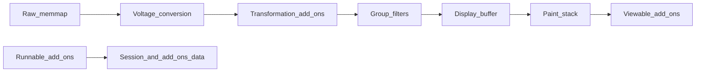
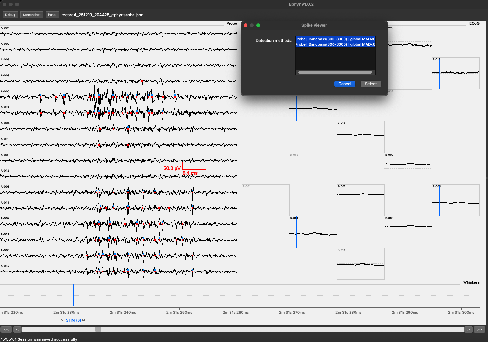
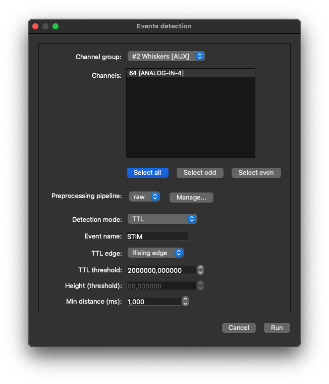

# Add-ons Workflow

Add-ons extend Ephyr without modifying its core code, providing an extensible system for integrating specialized analytical tools. 
Each add-on can independently implement or combine three capabilities:

| Type | What it does | Where it fits |
|------|--------------|---------------|
| **Execution** | Launches pre-configured processing routines to analyze session data, save results, or display them in a separate window | Initiated manually from the Add-on sub-panel of the Session panel, with optional configuration dialogs |
| **Transformation** | Modifies data after raw data conversion or reading and before preparation and visualization | Inside the data workflow, allowing previously generated results or custom processing routines to be applied during visualization |
| **Rendering** | Displays graphical overlays based on add-on outputs | In the Data panel, with configurable z-index positioning relative to traces, events, and periods |

Add-ons can be developed and distributed independently of Ephyr, then installed from the add-on repository and made available across sessions. Their capabilities can operate independently or interact with each other's results: Execution can generate analytical outputs, Transformation can use these outputs to modify data during visualization, and Rendering can represent the results as graphical objects.

## Logical data flow

1. Raw int16 samples are read from `sources/<source_id>/channel_N.samples`.
2. Values are converted to voltage for display.
3. Enabled **Transformation** add-ons reshape those samples per channel (when applicable).
4. Channel-group filters run next.
5. The result is downsampled into the display buffer drawn as traces.
6. **Viewable** add-ons paint additional graphics on top (or underneath, depending on z-index).
7. Separately, **Runnable** add-ons are started from the Add-ons panel. They can detect events, compute
   analyses, or write result files that other Viewable tools later overlay.

Session toggles for View / Transform are stored in `gui_setup.add_ons`. Persistent outputs usually live
under the Record’s `add_ons/data/$ADD_ON_MODULE_NAME/`.

## Example: Viewable — Spike viewer

**Spike viewer** overlays spike markers on the signal panel from detection results produced by Spike
detection (or compatible tools). You typically **Run** it once to choose which detection result folders
to display, then enable **View** so markers appear while you navigate the recording.

## Example: Runnable — Events detection

**Events detection** is a Runnable add-on that scans selected channels (TTL edge crossings or peaks above
a threshold) and appends detections to the session event vocabulary. After it finishes, the new events
appear in the signal panel and in the events table like manually placed labels.

For installing, searching, and running add-ons from the UI, see [Usage](usage.md).
For scaffolding your own module, see [Add-on Development](development.md).
