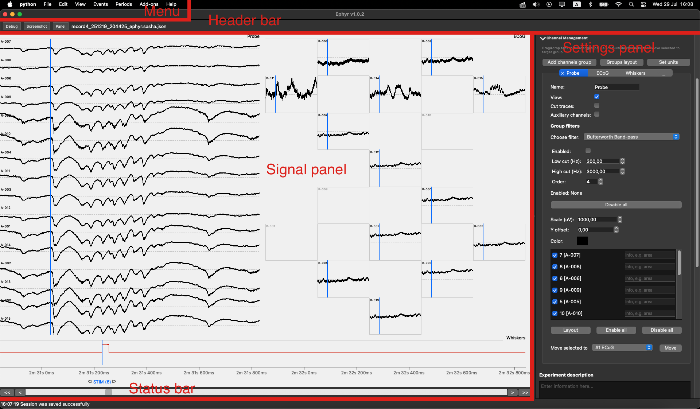

# Main Window

When a Record session is open, the Ephyr window is organized as follows.

## Layout overview

| Region | Role |
|--------|------|
| **Menu** | Global actions include opening workspaces, import recording, managing sessions, toggling visibility, labeling events and periods, managing add-ons, and opening Help. See [Menu](menu.md). |
| **Toolbar panel** | **Scalebar** turns the time/amplitude bar on or off. **Zoom to area** starts area selection (same as **V**). **Export Canvas** exports the current signal view (PNG/SVG). 
**Hide session panel** / **Show session panel** shows or hides the right-hand Session panel. |
| **Data panel** (left) | Contains channel groups with traces, events, periods, optional add-on overlays, and time navigation. See [Data Panel](signal_panel.md). |
| **Session panel** (right) | Includes Session panel mode selection (Beginner / Expert), timeline and channel settings, recording description, add-ons list, and application logs. See [Session Panel](settings_panel.md). |
| **Status bar** | Timestamped status messages from the application. The current session name, recording name, and folder appear on the right.|

Before any workspace is open, the left area shows a start screen with Create / Open / Recent. An empty
workspace shows **Add config** in the centre. A workspace with Configs but no open Record still shows
the recording navigation panel.

## Data panel highlights

Inside the data panel you will typically work with:

- **Time controls** — scrollbar, step buttons, and auto-scroll for navigating the recording
- **Channel groups** — arranged traces for one or more electrode groups
- **Events** — point markers on the time axis
- **Periods** — labeled time intervals
- **Tools** — measurement bar, area selection, and interactive labeling modes
- **Add-on overlays** — drawings from Viewable add-ons (for example spike markers)

## Session panel highlights

The Session panel begins with a mode selection (Beginner / Expert).  Additional sections are toggled independently 
from **View → Session Panel**: Recording Navigation, Timeline settings, Channel management, Add-ons, 
Recording description and Application logs. Recording Navigation is disabled by default.
