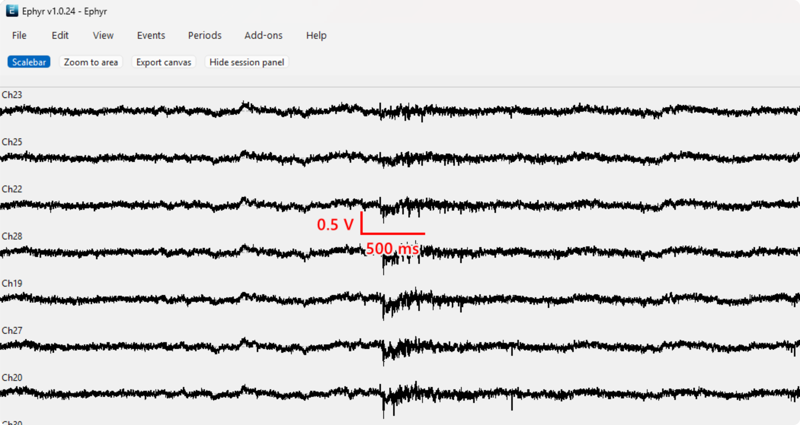
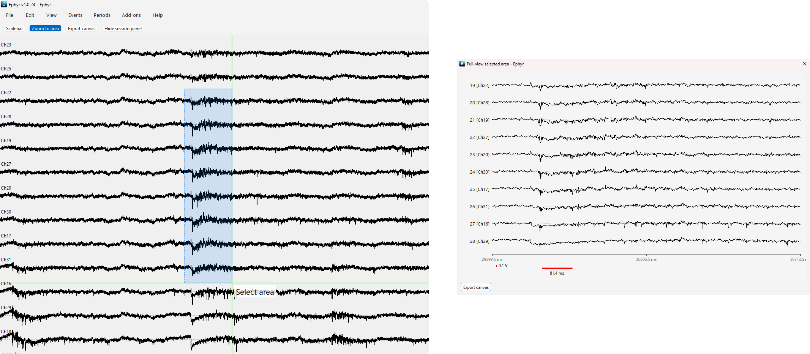
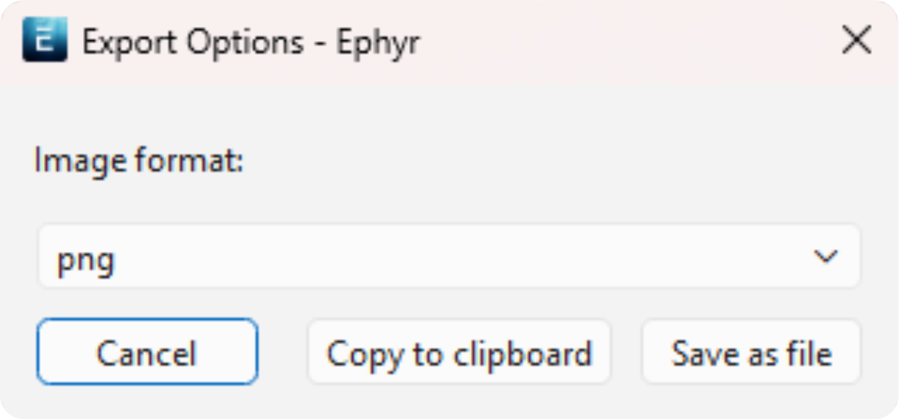

# Toolbar Panel

The toolbar contains a set of frequently used data analysis functions.

## Scalebar

Using the **Scalebar** button, you can add a scale marker to a specific area of the **Data panel**.

## Zoon to area

The **Zoom to area** button allows a selected area of the **Data panel** to be expanded in a separate window.

## Export canvas

The canvas from the **Data panel** can be saved in vector or raster format using **Export canvas**.

## Hide session panel

The **Data panel** itself can be enlarged by hiding the session panel using the **Hide session panel** button.