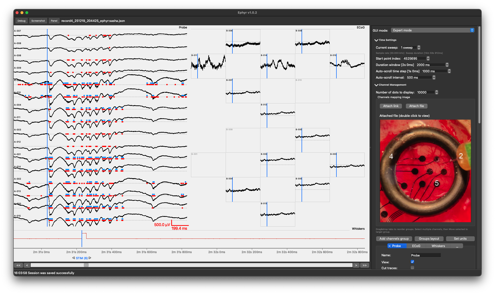

# Getting Started

**Ephyr** is a cross-platform desktop application for viewing and labeling electrophysiology data
(EEG, patch-clamp, multielectrode recordings, and similar signals). It supports Windows, macOS, and Linux.

This application is a lightweight yet powerful environment for multimodal annotation of electrophysiological data.
It combines an adaptive interface with intelligent performance scaling to match your machine’s resources,
ensuring stable real-time operation even under heavy loads.

Fully open-source and built in Python, the platform provides a flexible API for post-annotation data access.
Its add-on architecture lets you extend functionality seamlessly without modifying the core codebase.

After installation, launch the app with the `ephyr` command. The About dialog (Help → About) shows the
installed version as `Ephyr v…`.

## Where to go next

Depending on what you need, continue with one of these sections:

- **[Installation](installation.md)** — install Ephyr from PyPI (or check the status of the `.exe` installer) and start the GUI.
- **[Files Format](files_format.md)** — Workspace → Config → Record → Source → Segment, how to import recordings, and the on-disk layout.
- **[Graphic User Interface](gui/index.md)** — main window layout, menus, signal panel, and settings panel.
- **[Add-ons](add_ons/index.md)** — how Viewable, Runnable, and Transformation add-ons fit into the workflow, how to install and run them, and how to develop your own.
- **[Reading Sources](analysis/sources.md)** — how to import recordings into a workspace from Python, one at a time or in batches.
- **[Using Labeled Data](analysis/labeled_data.md)** — how to load a labeled Record in Python (`EphyrSessionManager`), read signals, sessions, events, periods, and spike sets.
